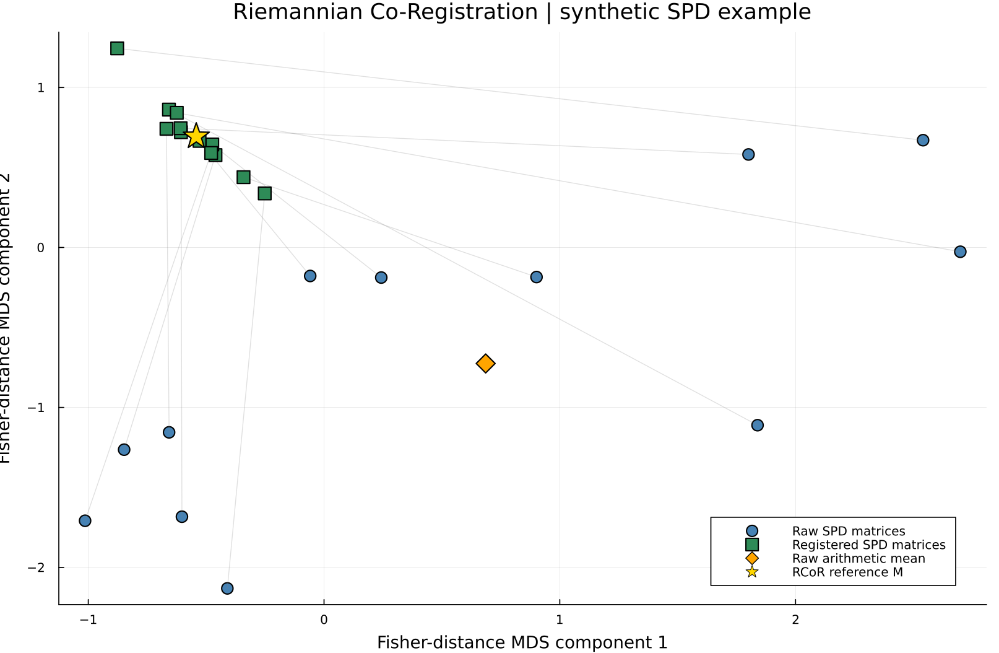
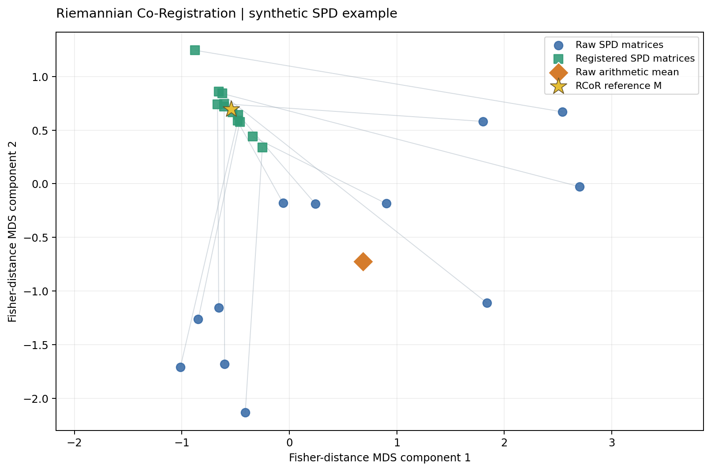

<p align="center">
  
</p>

# 🧠 RCoR — Riemannian Co-Registration

**RCoR** is a method for co-registering real symmetric positive-definite (SPD) matrices by expressing them in a common orthogonal eigenvector basis. The repository provides independent implementations in **Python** and **Julia**.

In particular, RCoR provides tools for:

- Resolving the sign ambiguity of eigenvectors across a collection of SPD matrices.
- Refining eigenvector alignment by maximizing the nuclear norm of their signed sum.
- Constructing a common orthogonal basis and registered SPD matrices.
- Computing a reference SPD matrix from the geometric means of the ordered eigenvalues.

The repository includes:

> - A Python implementation of `rr` in [`python/rcor_nuclear/core.py`](python/rcor_nuclear/core.py).
> - A Julia implementation of `rr` in [`julia/RR_nuclear_optimized_final.jl`](julia/RR_nuclear_optimized_final.jl).
> - Reproducible examples and visual comparisons using synthetic SPD matrices.

Both implementations follow the same mathematical approach, combining column-wise sign initialization with iterative nuclear-norm refinement.

---

## 📌 Index

- 📥 [Installation](#-installation)
- 📖 [Problem Statement, Notation and Nomenclature](#-problem-statement-notation-and-nomenclature)
- 📑 [API](#-api)
- 📝 [Examples](#-examples)
- 🗂️ [Repository Structure](#️-repository-structure)
- 🪪 [About the Authors and Acknowledgment](#-about-the-authors-and-acknowledgment)
- 📎 [Contribute](#-contribute)
- 🎓 [References](#-references)

---

## 📥 Installation

Clone the repository and open its root directory:

```bash
git clone https://github.com/Lucreziadimarino/RCoR.git
cd RCoR
```

### Python

Python **3.10 or newer** is required. Install the project from the repository root:

```bash
python -m pip install -e ".[plot]"
```

The core algorithm uses NumPy; the plotting examples additionally use SciPy and Matplotlib.

### Julia

Install the dependencies from the Julia REPL:

```julia
using Pkg
Pkg.add(["PosDefManifold", "Diagonalizations", "Plots"])
```

The Julia implementation is provided as a source file and can be loaded with `include` from the repository root.

[▲ index](#-index)

---

## 📖 Problem Statement, Notation and Nomenclature

### SPD matrices and eigendecompositions

Let $C_1,\ldots,C_n\in\mathcal S_{++}^{d}$ be real SPD matrices, where $n$ is the number of matrices and $d$ is their common dimension. Their eigendecompositions are

$$
C_i=U_i\Lambda_i U_i^{\mathsf T},
\qquad U_i\in O(d),\qquad
\Lambda_i=\mathrm{diag}(\lambda_{i1},\ldots,\lambda_{id}).
$$

The eigenvalues are ordered from largest to smallest. Here, $O(d)$ denotes the orthogonal group. Each eigenvector is defined only up to its sign: replacing $U_i$ with $U_iS_i$, where

$$
S_i=\mathrm{diag}(s_{i1},\ldots,s_{id}),
\qquad s_{ij}\in\{-1,+1\},
$$

does not change $C_i$.

### Eigenvector sign synchronization

The goal is to identify a common orthogonal basis while resolving these sign ambiguities. Define the **signed sum**

$$
A(S)=\sum_{i=1}^{n}U_iS_i,
\qquad S_1=I,
$$

where $S_1=I$ fixes an arbitrary global sign convention. The sign selection aims to maximize the **nuclear norm** (the sum of singular values):

$$
\boxed{\max_{S_2,\ldots,S_n}\|A(S)\|_*
=\max_{S_2,\ldots,S_n}\sum_{k=1}^{d}\sigma_k(A(S))}.
$$

For fixed signs, the closest common orthogonal matrix in Frobenius norm is the polar factor of $A(S)$. Accordingly,

$$
\min_{\Gamma\in O(d)}\sum_{i=1}^{n}
\|U_iS_i-\Gamma\|_F^2
=2nd-2\|A(S)\|_*.
$$

### Initialization and nuclear-norm refinement

The implementation selects signs in two stages:

1. **Column-wise initialization.** For each eigenvector index $j$, enumerate all $2^{n-1}$ sign patterns, holding $s_{1j}=+1$ fixed, and maximize $\|A(S)_{:,j}\|_2^2$. Because the squared Frobenius norm separates by columns, this stage exactly maximizes $\|A(S)\|_F^2$.
2. **Nuclear-norm refinement.** Starting from the initialized signs, visit individual sign variables and accept a flip only if it improves $\|A(S)\|_*$ by more than `tol`. Stop when no improving flip remains or after `maxiter` passes.

The refinement uses coordinate-wise sign updates that improve the nuclear-norm objective. It terminates when no further improving single-sign change is found or when the iteration limit is reached; this stopping criterion does not by itself establish global optimality.

### Common basis and registered matrices

After sign optimization, let $A(S)=P\Sigma Q^{\mathsf T}$ be a singular value decomposition. The common orthogonal basis is

$$
\boxed{\Gamma=PQ^{\mathsf T}}.
$$

The registered matrices retain their original ordered eigenvalues but share the common basis:

$$
\boxed{G_i=\Gamma\Lambda_i\Gamma^{\mathsf T}}.
$$

The reference SPD matrix is constructed from the componentwise geometric mean of the eigenvalues:

$$
\ell_j=\exp\left(\frac{1}{n}\sum_{i=1}^{n}\log\lambda_{ij}\right),
\qquad
\boxed{M=\Gamma\mathrm{diag}(\ell_1,\ldots,\ell_d)\Gamma^{\mathsf T}}.
$$

The two implementations return the reference matrix $M$, the common basis $\Gamma$, and the collection of registered matrices $G$.

[▲ index](#-index)

---

## 📑 API

| Implementation | Function | Description |
|:--|:--|:--|
| Python | [`rr`](#python-api) | Compute the RCoR reference, common basis, and registered matrices from a collection of SPD matrices. |
| Julia | [`rr`](#julia-api) | Perform the corresponding co-registration with the PosDefManifold.jl interface. |

### Python API

```python
from rcor_nuclear import rr

M, Gamma, G = rr(C)
```

**Input:** `C` is a collection of `n` real SPD matrices of size `d × d`, represented in the example below by a NumPy array of shape `(n, d, d)`.

**Optional parameters:** `tol=1e-12` and `maxiter=100` control the sign-flip acceptance threshold and the maximum number of refinement passes.

**Returns:**

| Value | Meaning | Shape |
|:--|:--|:--|
| `M` | Reference SPD matrix | `(d, d)` |
| `Gamma` | Common orthogonal eigenvector basis | `(d, d)` |
| `G` | Registered SPD matrices | `(n, d, d)` |

Source: [`python/rcor_nuclear/core.py`](python/rcor_nuclear/core.py).

[▲ API index](#-api) · [▲ index](#-index)

### Julia API

```julia
using LinearAlgebra, PosDefManifold, Diagonalizations
include("julia/RR_nuclear_optimized_final.jl")

M, Γ, 𝐆 = rr(C)
```

**Input:** `C` is a collection of SPD matrices using `PosDefManifold.jl` types (`ℍ` and `ℍVector`).

**Returns:** `M` (reference SPD matrix), `Γ` (common orthogonal basis), and `𝐆` (registered matrices).

Source: [`julia/RR_nuclear_optimized_final.jl`](julia/RR_nuclear_optimized_final.jl).

[▲ API index](#-api) · [▲ index](#-index)

---

## 📝 Examples

### Python: minimal example

```python
import numpy as np
from rcor_nuclear import rr

C = np.stack([
    np.diag([5.0, 2.0, 0.5]),
    np.array([[3.0, 0.4, 0.0],
              [0.4, 2.0, 0.2],
              [0.0, 0.2, 0.9]]),
])

M, Gamma, G = rr(C)
print(M.shape)      # (3, 3)
print(Gamma.shape)  # (3, 3)
print(G.shape)      # (2, 3, 3)
```

### Julia: minimal example

```julia
using LinearAlgebra, PosDefManifold, Diagonalizations
include("julia/RR_nuclear_optimized_final.jl")

C = ℍVector([
    ℍ(Matrix(Diagonal([5.0, 2.0, 0.5]))),
    ℍ([3.0 0.4 0.0; 0.4 2.0 0.2; 0.0 0.2 0.9]),
])

M, Γ, 𝐆 = rr(C)
```

### RCoR scatterplot: Julia and Python

The example scripts process the **same 12 synthetic SPD matrices of size 8 × 8** and display four groups in a common two-dimensional representation:

- Original SPD matrices (circles).
- Registered SPD matrices (squares).
- Arithmetic mean of the original matrices (diamond).
- RCoR reference matrix $M$ (star).

The visualization is based on **classical multidimensional scaling (MDS)** applied to pairwise affine-invariant (Fisher) distances between SPD matrices. The two-dimensional configuration illustrates relative relationships; it does not represent individual eigenvalues.

<table>
  <tr>
    <th align="center">Julia</th>
    <th align="center">Python</th>
  </tr>
  <tr>
    <td width="50%" align="center">
      
    </td>
    <td width="50%" align="center">
      
    </td>
  </tr>
</table>

*The 2D MDS axes are arbitrary up to rotation and reflection. Compare relative point configurations, not absolute coordinates.*

### Reproduce the figures

Run these commands from the repository root:

```bash
python examples/demo_scatter.py
julia examples/demo_scatter.jl
```

The scripts save their plots to:

- `examples/output/rcor_scatter_python.png`
- `examples/output/rcor_scatter_julia.png`

The corresponding figures are also included in `assets/`. A notebook is available at [`examples/demo_scatter.ipynb`](examples/demo_scatter.ipynb).

[▲ index](#-index)

---

## 🗂️ Repository Structure

```text
RCoR/
├── assets/
│   ├── intense-logo.png
│   ├── scatter_example_julia.png
│   └── scatter_example_python.png
├── examples/
│   ├── data/demo_variable_spectra_n12_d8/
│   ├── demo_scatter.jl
│   ├── demo_scatter.py
│   └── demo_scatter.ipynb
├── julia/
│   └── RR_nuclear_optimized_final.jl
├── python/
│   └── rcor_nuclear/
│       ├── __init__.py
│       └── core.py
├── .gitignore
├── pyproject.toml
└── README.md
```

Local research datasets and generated example outputs are excluded from version control according to `.gitignore`; the repository supplies synthetic examples rather than private validation material.

[▲ index](#-index)

---

## 🪪 About the Authors and Acknowledgment

RCoR was developed in the context of the **INTENSE** project. The work was financially supported by the **Ministry of Enterprises and Made in Italy (MIMIT)**.

For project maintenance and authorship information, refer to the [repository](https://github.com/Lucreziadimarino/RCoR) and its commit history.

[▲ index](#-index)

---

## 📎 Contribute

Suggestions, bug reports, and improvements can be submitted through the repository's [GitHub Issues](https://github.com/Lucreziadimarino/RCoR/issues).

When reporting a problem, please include the implementation (Python or Julia), a minimal reproducible example, and relevant version information. Do not upload private research datasets or validation artifacts.

[▲ index](#-index)

---

## 🎓 References

Schiavon, J. (2022). *Geometria differenziale delle matrici simmetriche e definite positive per applicazioni statistiche*. PhD thesis, University of Padua, Italy. [https://hdl.handle.net/11577/3449438](https://hdl.handle.net/11577/3449438).

Schiavon's thesis provides a theoretical reference on the Riemannian geometry and co-registration of symmetric positive-definite matrices. The specific sign-initialization and nuclear-norm refinement procedures implemented in RCoR are described in the sections above.

[▲ index](#-index)
